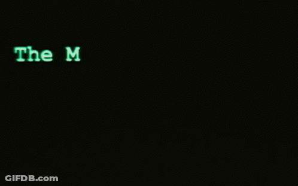

<!-- Ayush Burman | GitHub profile README -->

<!-- ============ HEADER ============ -->
<div align="center">


<a href="https://github.com/ayushbrmn08">
  
</a>

<br/>

<a href="https://linkedin.com/in/ayushbrmn08"></a>
<a href="mailto:ayushbrmn08@gmail.com"></a>
<a href="https://github.com/ayushbrmn08?tab=followers"></a>


<br/><br/>



</div>


<!-- ============ ABOUT ============ -->
## `>_` whoami

```bash
ayush@iiit-ranchi:~$ cat profile.ts
```

```ts
const ayush = {
  name:       "Ayush Burman",
  studying:   "B.Tech CSE @ IIIT Ranchi",
  focus:      ["full-stack", "backend"],
  building:   ["React", "Next.js", "Node.js", "FastAPI"],
  data:       ["MongoDB", "MySQL", "PostgreSQL"],
  cloud:      ["Google Cloud", "Vercel"],
  sharpening: ["DSA", "problem solving", "SWE"],
  exploring:  ["open source", "backend systems", "AI"],
};
```

**`~/now`**

- Strengthening DSA and fundamentals
- Shipping full-stack side projects
- Looking for open-source repos to contribute to

**`?` ask me about:** React · Next.js · Node.js · FastAPI · MongoDB


<!-- ============ TECH STACK ============ -->
## `{}` stack

What I build with, grouped by layer.

<div align="center">

| area | tools |
| :--- | :--- |
| **lang** |  |
| **frontend** |  |
| **backend** |  |
| **db** |  |
| **tools / cloud** |  |

</div>


<!-- ============ PROJECTS ============ -->
## `</>` projects

A few things I've built. Click a card to open the repo.

<div align="center">

<a href="https://github.com/ayushbrmn08/Hash-Cracker-GUI"></a>
<a href="https://github.com/ayushbrmn08/Newsletter-Signup"></a>
<a href="https://github.com/ayushbrmn08/Simon-Game"></a>
<a href="https://github.com/ayushbrmn08/Dice-Game"></a>

<a href="https://github.com/ayushbrmn08?tab=repositories"></a>

</div>


<!-- ============ STATS ============ -->
## `#` stats

Live numbers from my GitHub activity.

<div align="center">


</div>


<!-- ============ QUOTE ============ -->
## `$` fortune

<!-- QUOTE:START -->
<p align="center"></p>
<!-- QUOTE:END -->


<!-- ============ CONNECT ============ -->
## `@` connect

Always up for connecting with developers, contributing to open source, collaborating on projects, and learning from the community. If something here looks interesting, reach out.

<div align="center">

<a href="https://linkedin.com/in/ayushbrmn08"></a>
<a href="mailto:ayushbrmn08@gmail.com"></a>
<a href="https://github.com/ayushbrmn08"></a>

<br/><br/>


<sub><code>$ git commit -m "thanks for stopping by"</code></sub>

</div>


